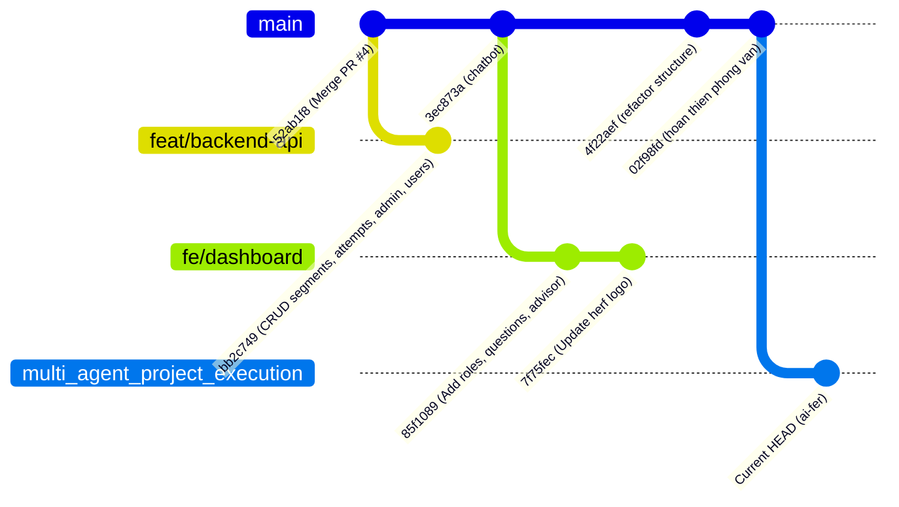
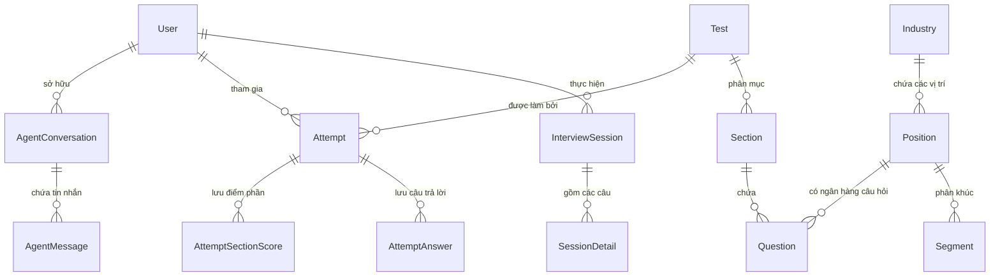

# BẢN ĐẶC TẢ VÀ KẾ HOẠCH THỰC THI TÍCH HỢP HỆ THỐNG
# AI MOCK INTERVIEW PLATFORM

> **Tài liệu tham chiếu:** Single Source of Truth (SSOT) cho việc tích hợp nhánh Backend API (`origin/feat/backend-api`) và Frontend Dashboard (`origin/fe/dashboard`) vào nhánh phỏng vấn AI Đa phương thức (`feat/ai-fer` / `multi_agent_project_execution`).  
> **Tác giả:** Architect Agent  
> **Trạng thái:** Chấp thuận & Sẵn sàng bàn giao thực thi (Approved for Execution)  
> **Ngôn ngữ:** Tiếng Việt (Tài liệu đặc tả) / Tiếng Anh (Mã nguồn, Schema, Identifiers)  

---

## 1. MỤC TIÊU VÀ PHẠM VI (OVERVIEW & SCOPE)

### 1.1. Bối cảnh & Mục tiêu
Dự án **AI Mock Interview Platform** hiện đã xây dựng hoàn thiện tính năng phỏng vấn cốt lõi trên nhánh `feat/ai-fer` (nhận diện cảm xúc khuôn mặt FER ONNX, phân tích giọng nói Groq Whisper STT, đánh giá chuyên môn và phản hồi đa chiều Google Gemini Flash, lưu trữ video câu trả lời trên Firebase Storage, và AI Coach Chatbot).

Song song đó, hai nhánh tính năng vệ tinh đã được phát triển:
1. `origin/feat/backend-api`: Xây dựng CRUD Phân khúc ngành nghề/vị trí (`/api/segments`), Lịch sử làm bài trắc nghiệm/đánh giá chi tiết (`/api/user/attempts`), Phân quyền Quản trị viên (`/api/admin`), Quản lý Hồ sơ và Đổi mật khẩu người dùng (`/api/user`).
2. `origin/fe/dashboard`: Xây dựng giao diện Trang chủ ứng viên (`UserHomePage`), Lịch sử phỏng vấn đa chỉ số (`HistoryPage`), Trợ lý AI Cố vấn tổng thể (`AdvisorChat`), Chọn vị trí phỏng vấn theo Level và xem trước ngân hàng câu hỏi (`SetupPage`).

**Mục tiêu tối thượng của kế hoạch này:**
- Hợp nhất mã nguồn 2 nhánh trên vào nhánh hiện tại một cách an toàn, triệt tiêu toàn bộ xung đột (merge conflicts).
- Kết nối dữ liệu thực tế (API Wiring) giữa Frontend và Backend cho tất cả các tính năng mới.
- **Bảo vệ tuyệt đối 100% tính năng phỏng vấn hiện tại** (Không gây lỗi suy thoái - Zero Regression cho `InterviewRoom`, FER, Whisper, Gemini, Firebase, và Chatbot).

### 1.2. Phạm vi Thực hiện (In-Scope vs Out-of-Scope)
- **Trong phạm vi (In-Scope):**
  - Hợp nhất cấu hình dependencies (`requirements.txt`), schemas (`backend/schemas.py`), models (`backend/models.py`), endpoints (`backend/main.py`), giao diện (`App.jsx`, `SetupPage.jsx`, `api.js`).
  - Chuẩn hóa CSDL quan hệ: Bổ sung các Model còn thiếu (`Test`, `Section`, `Question`, `Industry`, `Position`, `Segment`, `Attempt`, `AttemptAnswer`, `AttemptSectionScore`), tự động migration và nạp Seed Data mẫu.
  - Hoàn thiện các API trung gian còn thiếu phục vụ Frontend Dashboard (`/api/questions/positions`, `/api/questions`, `/api/sessions/history`, `/api/sessions/recent`, `/api/agents/chat`).
  - Kiểm thử tự động đa tầng: Unit test, API integration test, và E2E regression test.
- **Ngoài phạm vi (Out-of-Scope):**
  - Không sửa đổi logic toán học của mô hình ONNX FER hoặc trọng số nhận diện cảm xúc.
  - Không thay đổi hợp đồng API truyền file video câu trả lời phỏng vấn đã ổn định.

---

## 2. CHIẾN LƯỢC MERGE NHÁNH VÀ XỬ LÝ XUNG ĐỘT (GIT MERGE & CONFLICT RESOLUTION)

### 2.1. Phân tích Xung đột Chi tiết



#### Xung đột với `origin/feat/backend-api`:
1. `backend/requirements.txt`:
   - Nhánh hiện tại: `onnx>=1.15.0`, `onnxruntime>=1.17.0`, `-r requirements-speech-llm.txt`, `firebase-admin>=6.5.0`.
   - Nhánh backend-api: `passlib[bcrypt]>=1.7.4`.
   - *Cách giải quyết:* **Giữ cả hai**. Bổ sung thêm `passlib[bcrypt]>=1.7.4` và `bcrypt>=4.0.0` vào cuối file `requirements.txt`.
2. `backend/schemas.py`:
   - Nhánh hiện tại: `ChatRequest`, `ChatResponse` phục vụ AI Coach.
   - Nhánh backend-api: `SegmentBase`, `SegmentCreate`, `SegmentUpdate`, `SegmentResponse`, `SubmitAnswerRequest`, `AttemptSummaryResponse`, `AttemptAnswerDetail`, `AttemptSectionDetail`, `AttemptFullDetailResponse`, `IndustryCreate`, `PositionCreate`, `UserProfileResponse`, `UserProfileUpdate`, `ChangePasswordRequest`.
   - *Cách giải quyết:* **Giữ cả hai**. Gom nhóm có thứ tự, không xóa bất kỳ Schema nào của nhánh hiện tại.
3. `backend/models.py`:
   - Nhánh hiện tại: `SessionDetail` có cột `video_url = Column(String(500), nullable=True)` (lưu link Firebase).
   - Nhánh backend-api: Không có `video_url`, nhưng bổ sung các model `Segment`, `Industry`, `Position`, `Attempt`, `AttemptAnswer`, `AttemptSectionScore`.
   - **CẢNH BÁO NGUY HIỂM TỪ BACKEND-API:** `backend-api` khai báo `ForeignKey("tests.id")`, `ForeignKey("sections.id")`, `ForeignKey("questions.id")` nhưng **quên không định nghĩa các class Model `Test`, `Section`, `Question`**! Nếu giữ nguyên, SQLAlchemy sẽ văng ngoại lệ `NoReferencedTableError` và làm sập toàn bộ backend.
   - *Cách giải quyết:* Bổ sung đầy đủ định nghĩa ORM model cho `Test`, `Section`, `Question` vào `backend/models.py`. Đồng thời giữ lại `video_url` và bổ sung trường `level` vào `InterviewSession`.
4. `backend/api/sessions.py`:
   - Nhánh backend-api sửa đường dẫn file tạm thành cứng `temp_dir = "/tmp/"` và bỏ `video_url` trong `get_session_results`.
   - Nhánh hiện tại có cơ chế an toàn đa nền tảng (Windows dùng `tempfile.gettempdir()`, Linux dùng `/tmp/`) và trả về `video_url`.
   - *Cách giải quyết:* **Ưu tiên 100% code nhánh hiện tại**. Giữ nguyên logic xử lý file an toàn và `video_url`.
5. `backend/main.py`:
   - Nhánh hiện tại nạp biến môi trường `.env`, `sys.path`, và router `chatbot_router`.
   - Nhánh backend-api include các router `segments_router`, `attempts_router`, `admin_router`, `users_router`.
   - *Cách giải quyết:* Giữ nguyên cấu hình `.env` và `chatbot_router`, sau đó `include_router` thêm 4 routers mới từ backend-api.
6. File rác `"\306\260"`:
   - Nhánh backend-api có commit nhầm 1 file tên ký tự gõ phím lỗi `"\306\260"`.
   - *Cách giải quyết:* Xóa bỏ (delete) hoàn toàn file này khi merge.

#### Xung đột với `origin/fe/dashboard`:
1. `frontend/src/App.jsx`:
   - Nhánh hiện tại: Quản lý session trong `localStorage` (`interviewlab_current_session`, `interviewlab_last_session_id`, `interviewlab_user`), điều hướng kết quả `/results?session_id=...`, ngắt luồng camera an toàn, tích hợp đầy đủ flow `InterviewRoom` -> `DashboardPage`.
   - Nhánh fe/dashboard: Thêm `UserHomePage` (khi route/activeSection là 'home'), `HistoryPage` (khi activeSection là 'history'), `handleStartFromHome(preset)` truyền vị trí và level vào `SetupPage`.
   - *Cách giải quyết:* Hợp nhất giao diện menu sidebar và định tuyến `renderSection()`. Giữ nguyên cơ chế state/localStorage của nhánh hiện tại; kết nối `UserHomePage` và `HistoryPage` vào giao diện chính; hỗ trợ đăng xuất dọn dẹp sạch localStorage.
2. `frontend/src/pages/SetupPage.jsx`:
   - Nhánh hiện tại: Chọn vị trí dạng dropdown cứng, nhập JD, nút Bắt đầu.
   - Nhánh fe/dashboard: Tải danh sách vị trí động từ `api.getPositions()`, chọn Level chip, xem trước danh sách câu hỏi qua `api.getQuestions({ positionId, level })`.
   - *Cách giải quyết:* Áp dụng giao diện hiện đại của `fe/dashboard` nhưng đảm bảo hàm `handleStart` gọi `api.startSession` truyền dữ liệu an toàn, fallback thông minh nếu mạng gặp trục trặc.
3. `frontend/src/services/api.js`:
   - Hợp nhất toàn bộ các API functions của `fe/dashboard` (`getPositions`, `getQuestions`, `getSessionHistory`, `getRecentResults`, `chatWithAgent`, `listConversations`, `saveConversation`, `deleteConversation`) với cơ chế `withMock` bọc ngoài an toàn.
   - Giữ nguyên các hàm cốt lõi: `startSession`, `submitAnswerVideo`, `getSessionResults`, `getRoles`.
4. `frontend/src/styles.css`:
   - Giữ nguyên CSS cũ và append toàn bộ CSS mới của `fe/dashboard` (các class `.uh-*`, `.agent-*`, `.history-*`, `.level-chip*`).

### 2.2. Trình tự Thao tác Git Chuẩn mực
Các Builder Agent cần thực hiện tuần tự:
```powershell
# Bước 1: Fetch toàn bộ các nhánh remote mới nhất
git fetch origin feat/backend-api
git fetch origin fe/dashboard

# Bước 2: Tạo nhánh merge an toàn hoặc merge trực tiếp với cờ không tự động commit
git merge origin/feat/backend-api --no-commit --no-ff

# Bước 3: Giải quyết các file xung đột theo quy tắc tại mục 2.1
# Xóa file rác
git rm -f --ignore-unmatch "\306\260" "ư"

# Bước 4: Hoàn thành commit merge nhánh backend-api
git commit -m "chore: merge branch feat/backend-api into integration branch"

# Bước 5: Tiếp tục merge nhánh fe/dashboard
git merge origin/fe/dashboard --no-commit --no-ff

# Bước 6: Giải quyết các xung đột frontend và commit
git commit -m "chore: merge branch fe/dashboard into integration branch"
```

---

## 3. THIẾT KẾ CƠ SỞ DỮ LIỆU (DATABASE MODELS, MIGRATIONS & SEED DATA)

### 3.1. Sơ đồ Quan hệ Thực thể (ERD Diagram)



### 3.2. Đặc tả Chi tiết các Bảng CSDL (SQLAlchemy 2.0 Models)

#### 1. Bảng `users`
| Tên cột | Kiểu dữ liệu | Ràng buộc | Mô tả |
| :--- | :--- | :--- | :--- |
| `id` | String(36) | PK, UUID | Khóa chính định danh người dùng |
| `email` | String(255) | Unique, Not Null, Index | Email đăng nhập |
| `full_name` | String(255) | Not Null | Họ và tên ứng viên / quản trị viên |
| `phone_number` | String(20) | Nullable | Số điện thoại liên hệ |
| `role` | String(20) | Default "USER" | Vai trò: `USER` hoặc `ADMIN` |
| `hashed_password` | String(255) | Nullable | Mật khẩu băm Bcrypt |
| `created_at` | DateTime | Default utcnow | Thời điểm tạo tài khoản |

#### 2. Bảng `interview_sessions` (Bảo vệ tính năng phỏng vấn)
| Tên cột | Kiểu dữ liệu | Ràng buộc | Mô tả |
| :--- | :--- | :--- | :--- |
| `id` | String(36) | PK, UUID | Mã phiên phỏng vấn |
| `user_id` | String(36) | FK(users.id), Nullable | Liên kết người dùng (nếu đã đăng nhập) |
| `role_name` | String(100) | Not Null | Vị trí phỏng vấn (VD: Backend Developer) |
| `level` | String(50) | Nullable, Default "fresher" | Mức độ: intern, fresher, junior, mid, senior |
| `jd_text` | Text | Nullable | Nội dung mô tả công việc (JD) ứng viên dán vào |
| `overall_score` | Float | Default 0.0 | Điểm tổng kết phiên phỏng vấn (thang 100) |
| `confidence_avg`| Float | Default 0.0 | Điểm tự tin trung bình từ FER |
| `stress_avg` | Float | Default 0.0 | Điểm căng thẳng trung bình từ FER |
| `status` | String(20) | Default "IN_PROGRESS" | `IN_PROGRESS` hoặc `COMPLETED` |
| `created_at` | DateTime | Default utcnow | Thời gian bắt đầu phiên |

#### 3. Bảng `session_details` (Bảo vệ video & AI critiques)
| Tên cột | Kiểu dữ liệu | Ràng buộc | Mô tả |
| :--- | :--- | :--- | :--- |
| `id` | String(36) | PK, UUID | Khóa chính câu hỏi trong phiên |
| `session_id` | String(36) | FK(interview_sessions.id) | Thuộc phiên phỏng vấn nào |
| `question_text` | Text | Not Null | Nội dung câu hỏi |
| `order_index` | Integer | Not Null | Thứ tự câu (1, 2, 3...) |
| `transcript` | Text | Nullable | Văn bản bóc băng từ Groq Whisper STT |
| `filler_words_count` | Integer | Default 0 | Số lượng từ đệm phát hiện |
| `confidence_score` | Float | Default 0.0 | Điểm tự tin của câu |
| `stress_score` | Float | Default 0.0 | Điểm căng thẳng của câu |
| `content_score` | Float | Default 0.0 | Điểm nội dung do Gemini chấm (thang 100) |
| `emotion_timeline` | JSON | Nullable | Mảng cảm xúc theo từng giây |
| `ai_feedback` | JSON | Nullable | Phản hồi chi tiết (content_critique, delivery, suggested) |
| `video_url` | String(500) | Nullable | Đường dẫn phát video trên Firebase Cloud Storage |
| `status` | String(20) | Default "PENDING" | `PENDING`, `PROCESSING`, `COMPLETED`, `FAILED` |
| `created_at` | DateTime | Default utcnow | Thời gian tạo |

#### 4. Bảng `industries` (Quản lý Ngành nghề)
| Tên cột | Kiểu dữ liệu | Ràng buộc | Mô tả |
| :--- | :--- | :--- | :--- |
| `id` | String(36) | PK, UUID | Mã ngành |
| `name` | String(255) | Not Null | Tên ngành (VD: Công nghệ thông tin) |
| `code` | String(50) | Unique, Not Null | Mã viết tắt (VD: IT) |
| `status` | String(20) | Default "ACTIVE" | `ACTIVE` hoặc `DELETED` |

#### 5. Bảng `positions` (Vị trí chuyên môn)
| Tên cột | Kiểu dữ liệu | Ràng buộc | Mô tả |
| :--- | :--- | :--- | :--- |
| `id` | String(36) | PK, UUID | Mã vị trí (VD: `backend`, `frontend`) |
| `industry_id` | String(36) | FK(industries.id), Not Null | Thuộc ngành nghề nào |
| `name` | String(255) | Not Null | Tên hiển thị (VD: Backend Developer) |
| `code` | String(50) | Nullable | Mã vị trí |
| `skills` | JSON | Nullable | Danh sách kỹ năng trọng tâm: `["Python", "FastAPI"]` |
| `duration` | String(50) | Default "3–6 tháng" | Thời gian khuyến nghị luyện tập |
| `icon` | String(50) | Default "server" | Icon hiển thị trên giao diện |
| `status` | String(20) | Default "ACTIVE" | `ACTIVE` hoặc `DELETED` |

#### 6. Bảng `segments` (Phân khúc)
| Tên cột | Kiểu dữ liệu | Ràng buộc | Mô tả |
| :--- | :--- | :--- | :--- |
| `id` | String(36) | PK, UUID | Mã phân khúc |
| `name` | String(255) | Not Null | Tên phân khúc (VD: Fresher Python Backend) |
| `code` | String(50) | Unique, Index, Nullable | Mã định danh |
| `description` | Text | Nullable | Mô tả chi tiết phân khúc |
| `industry_id` | String(36) | FK(industries.id), Not Null | Thuộc ngành |
| `position_id` | String(36) | FK(positions.id), Not Null | Thuộc vị trí |
| `status` | String(20) | Default "ACTIVE" | `ACTIVE` hoặc `DELETED` |
| `sort_order` | Integer | Default 0 | Thứ tự hiển thị |
| `created_at` | DateTime | Default utcnow | Ngày tạo |
| `updated_at` | DateTime | Default utcnow | Ngày cập nhật |

#### 7. Bảng `tests`, `sections`, `questions` (Khắc phục lỗi Foreign Key)
- **`tests`**: `id` (PK, String 36), `title` (String 255), `description` (Text), `created_at` (DateTime).
- **`sections`**: `id` (PK, String 36), `test_id` (FK tests.id, Nullable), `name` (String 255), `sort_order` (Integer).
- **`questions`**: `id` (PK, String 50), `section_id` (FK sections.id, Nullable), `position_id` (FK positions.id, Nullable), `category` (String 50), `question_text` (Text, Not Null), `correct_answer` (Text), `time_limit_seconds` (Integer, Default 120), `level` (String 50), `levels` (JSON, mảng các level áp dụng).

#### 8. Bảng `attempts`, `attempt_answers`, `attempt_section_scores`
- **`attempts`**: `id` (PK, String 36), `user_id` (FK users.id), `test_id` (FK tests.id), `started_at` (DateTime), `completed_at` (DateTime, Nullable), `total_score` (Float), `max_score` (Float), `status` (String 20: IN_PROGRESS / COMPLETED).
- **`attempt_answers`**: `id` (PK, String 36), `attempt_id` (FK attempts.id), `question_id` (FK questions.id), `user_answer` (Text), `correct_answer_snapshot` (Text), `is_correct` (Boolean), `score` (Float), `max_score` (Float).
- **`attempt_section_scores`**: `id` (PK, String 36), `attempt_id` (FK attempts.id), `section_id` (FK sections.id), `score` (Float), `max_score` (Float), `correct_count` (Integer), `question_count` (Integer).

#### 9. Bảng `agent_conversations` & `agent_messages` (Lưu trữ cố vấn AI)
- **`agent_conversations`**: `id` (PK, String 50), `user_id` (FK users.id, Nullable), `title` (String 255), `created_at` (DateTime), `updated_at` (DateTime).
- **`agent_messages`**: `id` (PK, String 50), `conversation_id` (FK agent_conversations.id), `role` (String 20: user / agent), `content` (Text), `created_at` (DateTime).

### 3.3. Kế hoạch Nạp Dữ liệu Mẫu (Seed Data)
Cần cập nhật file `backend/init_db.py` để khi chạy lệnh `python backend/init_db.py` sẽ tự động tạo bảng và nạp ngay:
1. **Tài khoản người dùng chuẩn:**
   - Quản trị viên: `id="admin_123"`, `email="admin@interviewlab.test"`, `full_name="Quản trị viên Hệ thống"`, `role="ADMIN"`, mật khẩu băm Bcrypt của `"Admin@123456"`.
   - Ứng viên mẫu: `id="user_123"`, `email="candidate@interviewlab.test"`, `full_name="Nguyễn Minh Đức"`, `phone_number="0912345678"`, `role="USER"`, mật khẩu băm Bcrypt của `"Candidate@123456"`.
2. **Dữ liệu Ngành nghề & Vị trí:**
   - 4 Ngành nghề: Công nghệ thông tin (`it`), Kinh doanh (`sales`), Phân tích dữ liệu (`data`), Quản trị nhân sự (`hr`).
   - 9 Vị trí chuyên môn: `backend`, `frontend`, `data-analyst`, `business-analyst`, `ai-engineer`, `system-analyst`, `sales`, `marketing`, `hr`.
3. **Ngân hàng câu hỏi chuẩn (Question Bank):**
   - Đưa toàn bộ các câu hỏi phân loại theo level (`intern`, `fresher`, `junior`, `mid`, `senior`) và nhóm năng lực (`Hành vi`, `Chuyên môn`, `Tình huống`, `Chiến lược`, `Lãnh đạo`) từ `mockData.js` vào bảng `questions`.
4. **Dữ liệu mẫu Lịch sử phỏng vấn:**
   - Nạp sẵn ít nhất 5 bản ghi `InterviewSession` và `Attempt` hoàn thành để ứng viên khi vừa đăng nhập vào `HistoryPage` hoặc `UserHomePage` là thấy ngay biểu đồ và danh sách trực quan.

---

## 4. HỢP ĐỒNG API VÀ KẾ HOẠCH NỐI API FRONTEND <-> BACKEND

### 4.1. Ma trận API Endpoints

```
+---------------------------------------------------------------------------------------------------+
| Nhóm Nghiệp Vụ    | Endpoint URL                           | Method | Mô Tả Chức Năng             |
+-------------------+----------------------------------------+--------+-----------------------------+
| Phỏng Vấn (Core)  | /api/sessions/start                    | POST   | Khởi tạo phiên phỏng vấn    |
|                   | /api/sessions/{id}/answer/{index}      | POST   | Upload video & phân tích AI |
|                   | /api/sessions/{id}/results             | GET    | Lấy bảng kết quả phỏng vấn  |
|                   | /api/sessions/{id}/chat                | POST   | Chatbot AI Coach theo phiên |
|                   | /api/sessions/{id}/chat/history        | GET    | Lấy lịch sử chat AI Coach   |
+-------------------+----------------------------------------+--------+-----------------------------+
| Lịch Sử & Home    | /api/sessions/history                  | GET    | Danh sách lịch sử phỏng vấn |
|                   | /api/sessions/recent                   | GET    | Top N phiên gần nhất        |
+-------------------+----------------------------------------+--------+-----------------------------+
| Ngân Hàng Câu Hỏi | /api/questions/roles                   | GET    | Danh sách roles cũ (compat) |
|                   | /api/questions/positions               | GET    | Danh sách vị trí & skills   |
|                   | /api/questions                         | GET    | Danh sách câu hỏi theo level|
+-------------------+----------------------------------------+--------+-----------------------------+
| AI Cố Vấn Advisor | /api/agents/chat                       | POST   | Tư vấn AI trên toàn lịch sử |
|                   | /api/agents/conversations              | GET    | Lấy danh sách hội thoại     |
|                   | /api/agents/conversations/{id}         | PUT    | Lưu hội thoại               |
|                   | /api/agents/conversations/{id}         | DELETE | Xóa hội thoại               |
+-------------------+----------------------------------------+--------+-----------------------------+
| Phân Khúc (Admin) | /api/segments                          | GET    | Danh sách phân khúc         |
|                   | /api/segments                          | POST   | Tạo phân khúc mới           |
|                   | /api/segments/{id}                     | GET    | Chi tiết phân khúc          |
|                   | /api/segments/{id}                     | PATCH  | Sửa phân khúc               |
|                   | /api/segments/{id}                     | DELETE | Xóa mềm phân khúc           |
+-------------------+----------------------------------------+--------+-----------------------------+
| Quản Trị Hệ Thống | /api/admin/industries                  | POST   | Thêm ngành nghề mới         |
|                   | /api/admin/industries/{id}             | DELETE | Xóa ngành nghề              |
|                   | /api/admin/positions                   | POST   | Thêm vị trí mới             |
|                   | /api/admin/positions/{id}              | DELETE | Xóa vị trí                  |
+-------------------+----------------------------------------+--------+-----------------------------+
| Tài Khoản & User  | /api/user/profile                      | GET    | Xem hồ sơ người dùng        |
|                   | /api/user/profile                      | PATCH  | Cập nhật thông tin cá nhân  |
|                   | /api/user/change-password              | POST   | Đổi mật khẩu                |
|                   | /api/user/attempts                     | GET    | Danh sách làm bài test      |
|                   | /api/user/attempts/{id}                | GET    | Chi tiết câu đúng/sai       |
|                   | /api/user/attempts/{id}/submit-answer  | POST   | Nộp đáp án từng câu         |
|                   | /api/user/attempts/{id}/complete       | POST   | Chốt điểm bài làm           |
+---------------------------------------------------------------------------------------------------+
```

### 4.2. Hợp đồng Payload Chi tiết cho các Endpoints mới

#### 1. `GET /api/questions/positions`
- **Query params:** `level` (optional, string: intern, fresher, junior, mid, senior)
- **Response Status:** `200 OK`
- **Response Body:**
```json
[
  {
    "id": "backend",
    "title": "Backend Developer",
    "field": "Công nghệ thông tin",
    "skills": ["Python", "FastAPI", "SQL"],
    "duration": "3–6 tháng",
    "icon": "server",
    "levels": ["intern", "fresher", "junior", "mid", "senior"]
  }
]
```

#### 2. `GET /api/questions`
- **Query params:** `position_id` (string, required), `level` (string, optional)
- **Response Status:** `200 OK`
- **Response Body:**
```json
{
  "position_id": "backend",
  "level": "fresher",
  "total": 4,
  "questions": [
    {
      "id": "backend-1",
      "category": "Hành vi",
      "question_text": "Bạn hãy giới thiệu bản thân và dự án backend ấn tượng nhất bạn từng tham gia?",
      "time_limit_seconds": 120
    }
  ]
}
```

#### 3. `POST /api/sessions/start` (Nâng cấp tương thích ngược)
- **Request Body:**
```json
{
  "role_name": "Backend Developer",
  "jd_text": "Tuyển dụng kỹ sư Backend Python...",
  "level": "fresher",
  "question_ids": ["backend-1", "backend-2", "backend-3"]
}
```
- **Response Status:** `200 OK`
- **Response Body:**
```json
{
  "session_id": "sess_8f29d10e-a4b5-4f33-8a02-5c3b1e779a01",
  "role_name": "Backend Developer",
  "level": "fresher",
  "total_questions": 3,
  "questions": [
    {
      "order_index": 1,
      "question_text": "Bạn hãy giới thiệu bản thân và dự án backend ấn tượng nhất bạn từng tham gia?",
      "time_limit_seconds": 120
    }
  ]
}
```

#### 4. `GET /api/sessions/history`
- **Response Status:** `200 OK`
- **Response Body:**
```json
[
  {
    "session_id": "mock_result_1",
    "role_name": "Backend Developer",
    "level": "fresher",
    "overall_score": 85.0,
    "content_score": 90.0,
    "voice_score": 80.0,
    "expression_score": 84.0,
    "filler_count": 9,
    "stress_level": "low",
    "feedback": "Nội dung chuyên môn tốt, cần giảm từ đệm ở phần mở đầu.",
    "created_at": "2026-10-17T10:32:00+07:00"
  }
]
```

#### 5. `POST /api/agents/chat` (AI Advisor thông minh)
- **Request Body:**
```json
{
  "conversation_id": "conv_12345",
  "message": "Em hay bị run và dùng nhiều từ đệm khi trả lời, làm sao để khắc phục?",
  "history": [
    { "role": "user", "content": "Chào chuyên gia" },
    { "role": "agent", "content": "Chào bạn, tôi có thể giúp gì cho bạn?" }
  ]
}
```
- **Response Status:** `200 OK`
- **Response Body:**
```json
{
  "reply": "Dựa trên dữ liệu các buổi phỏng vấn gần đây của bạn, điểm biểu cảm của bạn đạt 84/100 nhưng số lượng từ đệm là 9 từ...",
  "suggestions": [
    "Cách giảm từ đệm hiệu quả",
    "Luyện tập kỹ thuật hít thở 4-4-4",
    "Xem lại câu trả lời có nhiều từ đệm nhất"
  ]
}
```

### 4.3. Kế hoạch Nối API (Wiring Plan) trên Frontend
1. **Trong `frontend/src/services/api.js`:**
   - Xây dựng tầng Adapter chuẩn: Trước tiên gửi HTTP Request bằng `axios` tới backend (`/api/...`).
   - Nếu backend trả về mã `2xx`, parse và trả dữ liệu thật cho giao diện.
   - Nếu backend chưa sẵn sàng hoặc gặp lỗi mạng (500/404/Network Error), hàm `withMock` sẽ tự động kích hoạt fallback từ `mockData.js` hoặc `agentMock.js`. Điều này đảm bảo trải nghiệm giao diện người dùng **không bao giờ bị trắng trang (crash)**.
2. **Trong `frontend/src/pages/SetupPage.jsx`:**
   - Gọi `api.getPositions()` để render danh sách công việc.
   - Khi người dùng đổi vị trí hoặc chọn level, gọi `api.getQuestions({ positionId, level })` để cập nhật preview câu hỏi thời gian thực.
   - Khi bấm **"Bắt đầu Phỏng vấn Thử"**, gửi kèm `level` và danh sách `question_ids` đã chọn.
3. **Trong `frontend/src/pages/UserHomePage.jsx`:**
   - Đấu nối `api.getPositions({ level })` để hiển thị các thẻ công việc (Vị trí luyện tập gợi ý).
   - Đấu nối `api.getRecentResults(3)` hiển thị 3 bài phỏng vấn mới nhất kèm điểm số và ngày giờ.
4. **Trong `frontend/src/pages/HistoryPage.jsx`:**
   - Đấu nối `api.getSessionHistory()` hiển thị toàn bộ danh sách phiên phỏng vấn với các chỉ số: Nội dung, Giọng nói, Biểu cảm, Điểm tổng kết.
5. **Trong `frontend/src/components/AdvisorChat.jsx`:**
   - Đấu nối `api.listConversations()`, `api.chatWithAgent()`, `api.saveConversation()`, `api.deleteConversation()`.

---

## 5. CHIẾN LƯỢC BẢO VỆ TÍNH NĂNG PHỎNG VẤN HIỆN TẠI (ZERO-REGRESSION GUARANTEE)

> [!IMPORTANT]
> **Cam kết Bất khả xâm phạm:** Tính năng phỏng vấn thử trên nhánh hiện tại (`feat/ai-fer`) là tài sản cốt lõi và đã đạt độ ổn định cao. Bất kỳ sự thay đổi nào gây ảnh hưởng tiêu cực đến tính năng này đều bị từ chối phê duyệt.

### 5.1. Các Thành phần Cốt lõi Cần Bảo vệ
1. **Thư viện AI Đa phương thức:**
   - Trực quan cảm xúc (FER): File mô hình ONNX `backend/ai_core/fer/models/fer_model.onnx` và engine xử lý khung hình OpenCV.
   - Giọng nói & Ngữ âm (Speech-to-Text): Tích hợp Groq API Whisper và cơ chế dự phòng cục bộ, thuật toán đếm từ đệm tiếng Việt/Anh (`ừm`, `à`, `thì`, `là`, `you know`...).
   - Đánh giá Chuyên môn (LLM): Prompt kỹ thuật kết nối Google Gemini Flash sinh phản hồi 3 phần (`content_critique`, `delivery_critique`, `suggested_answer`).
2. **Xử lý File Tạm Đa Nền tảng (Windows & Linux Compatibility):**
   - Giữ nguyên cơ chế kiểm tra `os.name == "nt"`. Trên Windows, file video tạm ghi vào `os.path.join(tempfile.gettempdir(), "interview_tmp")`.
   - Tuyệt đối **không** áp đặt đường dẫn cứng `/tmp/` như commit nháp của backend-api.
3. **Upload Video & Đồng bộ Firebase Storage:**
   - Giữ nguyên cột `video_url` trong `SessionDetail` và hàm trả về link video trực tiếp trong `QuestionResultDetail`.
   - Đảm bảo candidate xem lại video của chính mình trên trang `DashboardPage.jsx`.
4. **Trạng thái Giao diện Phỏng vấn (`InterviewRoom.jsx`):**
   - Giữ nguyên luồng kích hoạt webcam stream, đồng hồ đếm ngược từng câu hỏi, cơ chế ghi hình MediaRecorder nhị phân (`recordedBlobs`).
   - Tắt camera tự động khi chuyển sang trang kết quả để giải phóng tài nguyên phần cứng.
5. **AI Coach Chatbot (`ChatbotService`):**
   - Giữ nguyên router `/api/sessions/{session_id}/chat` và các công cụ Function Calling trích xuất timeline cảm xúc.

---

## 6. KẾ HOẠCH BÓC TÁCH TÁC VỤ (TASK BREAKDOWN)

Kế hoạch được chia thành 5 giai đoạn (Phases) tuần tự, mỗi giai đoạn có tiêu chí nghiệm thu rõ ràng:

```
[Phase 1: Git Merge & Conflict Resolution]
                   │
                   ▼
[Phase 2: Database Models & Seed Data]
                   │
                   ▼
[Phase 3: Backend API Integration & Bridging]
                   │
                   ▼
[Phase 4: Frontend Integration & State Sync]
                   │
                   ▼
[Phase 5: QA Testing & End-to-End Verification]
```

### PHASE 1: MERGE NHÁNH VÀ XỬ LÝ XUNG ĐỘT (GIT MERGE & CONFLICT RESOLUTION)
- **Mục tiêu:** Nhập toàn bộ commit từ `origin/feat/backend-api` và `origin/fe/dashboard` vào nhánh hiện tại mà không để sót xung đột cú pháp.

| Task ID | Tên tác vụ | Phân bổ | File tạo / chỉnh sửa | Tiêu chí nghiệm thu (Acceptance Criteria) | Độ phức tạp |
| :--- | :--- | :--- | :--- | :--- | :--- |
| **T1.1** | Merge `origin/feat/backend-api` & giải quyết xung đột Backend | Builder (BE) | `backend/requirements.txt`<br>`backend/schemas.py`<br>`backend/models.py`<br>`backend/api/sessions.py`<br>`backend/main.py` | - Không còn conflict markers (`<<<<<<<`).<br>- Giữ đầy đủ dependencies (onnx, speech-llm, passlib).<br>- Giữ nguyên logic xử lý temp file an toàn trong `sessions.py`. | **M** |
| **T1.2** | Dọn dẹp file rác và kiểm tra cú pháp Backend | Builder (BE) | Xóa `"\306\260"` (nếu có) | - File rác được xóa hoàn toàn khỏi git index.<br>- Lệnh `python -m py_compile backend/main.py` không báo lỗi cú pháp. | **S** |
| **T1.3** | Merge `origin/fe/dashboard` & giải quyết xung đột Frontend | Builder (FE) | `frontend/src/App.jsx`<br>`frontend/src/pages/SetupPage.jsx`<br>`frontend/src/services/api.js`<br>`frontend/src/styles.css` | - Không còn conflict markers trong source code.<br>- App.jsx tích hợp đầy đủ các trang mới mà không phá vỡ logic lưu session.<br>- CSS mới được bổ sung đầy đủ. | **M** |

---

### PHASE 2: THIẾT KẾ CƠ SỞ DỮ LIỆU & SEED DATA (DATABASE SCHEMA & SEED DATA)
- **Mục tiêu:** Đảm bảo toàn bộ bảng quan hệ được tạo đầy đủ trong SQLite/PostgreSQL, giải quyết triệt để lỗi thiếu bảng tham chiếu ngoại lai.

| Task ID | Tên tác vụ | Phân bổ | File tạo / chỉnh sửa | Tiêu chí nghiệm thu (Acceptance Criteria) | Độ phức tạp |
| :--- | :--- | :--- | :--- | :--- | :--- |
| **T2.1** | Hoàn thiện định nghĩa ORM Models trong `models.py` | Builder (BE) | `backend/models.py` | - Bổ sung các class `Industry`, `Position`, `Segment`, `Test`, `Section`, `Question`, `Attempt`, `AttemptAnswer`, `AttemptSectionScore`, `AgentConversation`, `AgentMessage`.<br>- Bổ sung trường `level` vào `InterviewSession`.<br>- Giữ nguyên `video_url` trong `SessionDetail`. | **M** |
| **T2.2** | Nâng cấp Migration & Seed Data tự động trong `init_db.py` | Builder (BE) | `backend/init_db.py` | - Chạy `python backend/init_db.py` tạo thành công 100% các bảng.<br>- Nạp tài khoản `admin_123`, `user_123` có mật khẩu băm bcrypt hợp lệ.<br>- Nạp 4 ngành, 9 vị trí, ngân hàng câu hỏi theo 5 level, và các phiên phỏng vấn mẫu. | **M** |

---

### PHASE 3: HOÀN THIỆN API VÀ CẦU NỐI BACKEND (BACKEND API INTEGRATION)
- **Mục tiêu:** Cung cấp đầy đủ các API mà giao diện Dashboard và Lịch sử của Frontend yêu cầu.

| Task ID | Tên tác vụ | Phân bổ | File tạo / chỉnh sửa | Tiêu chí nghiệm thu (Acceptance Criteria) | Độ phức tạp |
| :--- | :--- | :--- | :--- | :--- | :--- |
| **T3.1** | Xây dựng API Ngân hàng câu hỏi & Vị trí (`questions.py`) | Builder (BE) | `backend/api/questions.py`<br>`backend/schemas.py` | - Endpoint `GET /api/questions/positions` trả về danh sách 9 vị trí kèm skills, level, icon.<br>- Endpoint `GET /api/questions` trả về danh sách câu hỏi theo `position_id` và `level`.<br>- Endpoint `GET /api/questions/roles` vẫn hoạt động tốt (tương thích ngược). | **M** |
| **T3.2** | Bổ sung API Lịch sử & Recent Sessions (`sessions.py`) | Builder (BE) | `backend/api/sessions.py`<br>`backend/schemas.py` | - Endpoint `GET /api/sessions/history` trả về danh sách phiên phỏng vấn kèm điểm con (content, voice, expression).<br>- Endpoint `GET /api/sessions/recent` trả về top N phiên gần nhất.<br>- Endpoint `POST /api/sessions/start` nhận thêm `level` và `question_ids`. | **M** |
| **T3.3** | Chuẩn hóa tầng xác thực `dependencies.py` | Builder (BE) | `backend/dependencies.py` | - `get_current_user` lấy người dùng linh hoạt từ header/token hoặc fallback về tài khoản mẫu `user_123`/`admin_123` để không bị 401 khi test local.<br>- `get_current_admin_user` kiểm tra `role == "ADMIN"`. | **S** |
| **T3.4** | Bổ sung API Cố vấn AI (`api/agents.py` hoặc `api/chatbot.py`) | Builder (BE) | `backend/api/agents.py`<br>`backend/main.py` | - Endpoint `POST /api/agents/chat` nhận câu hỏi tư vấn, phân tích dựa trên lịch sử phỏng vấn của user và trả về lời khuyên + gợi ý.<br>- Endpoint CRUD hội thoại: `/api/agents/conversations`. | **M** |

---

### PHASE 4: ĐẤU NỐI & ĐỒNG BỘ GIAO DIỆN FRONTEND (FRONTEND INTEGRATION)
- **Mục tiêu:** Toàn bộ các trang mới trên Frontend kết nối trực tiếp với Backend API, loại bỏ hardcoded mock nhưng giữ fallback an toàn.

| Task ID | Tên tác vụ | Phân bổ | File tạo / chỉnh sửa | Tiêu chí nghiệm thu (Acceptance Criteria) | Độ phức tạp |
| :--- | :--- | :--- | :--- | :--- | :--- |
| **T4.1** | Chuẩn hóa API Client `api.js` | Builder (FE) | `frontend/src/services/api.js` | - Các hàm `getPositions`, `getQuestions`, `getSessionHistory`, `getRecentResults`, `chatWithAgent` gọi đúng API backend thật.<br>- Fallback `withMock` tự động kích hoạt mượt mà nếu backend lỗi. | **M** |
| **T4.2** | Đấu nối `SetupPage.jsx` & `UserHomePage.jsx` | Builder (FE) | `frontend/src/pages/SetupPage.jsx`<br>`frontend/src/pages/UserHomePage.jsx` | - `UserHomePage` hiển thị vị trí động từ API, click chuyển sang `SetupPage` mang theo preset.<br>- `SetupPage` render câu hỏi theo level xem trước từ API; khởi tạo phiên phỏng vấn thành công. | **M** |
| **T4.3** | Đấu nối `HistoryPage.jsx` & `AdvisorChat.jsx` | Builder (FE) | `frontend/src/pages/HistoryPage.jsx`<br>`frontend/src/components/AdvisorChat.jsx` | - `HistoryPage` hiển thị lịch sử từ API backend.<br>- Tab Cố vấn AI (`AdvisorChat`) trò chuyện với API `/api/agents/chat`. | **M** |
| **T4.4** | Đấu nối Quản trị Vị trí trong `AdminInterviews.jsx` | Builder (FE) | `frontend/src/pages/Admin/AdminInterviews.jsx` | - Trang Admin hiển thị danh sách vị trí lấy từ backend; cho phép tạo vị trí mới qua `POST /api/admin/positions`. | **S** |
| **T4.5** | Hoàn thiện định tuyến & Navigation trong `App.jsx` | Builder (FE) | `frontend/src/App.jsx` | - Điều hướng chuyển đổi mượt mà giữa các tab Home, Interview, History, Profile, Admin.<br>- Quá trình làm bài phỏng vấn tại `InterviewRoom` -> `DashboardPage` diễn ra chuẩn xác 100%. | **M** |

---

### PHASE 5: KIỂM THỬ ĐỘC LẬP & XÁC THỰC TOÀN DIỆN (QA TESTING & VERIFICATION)
- **Mục tiêu:** Kiểm định chất lượng độc lập, ngăn ngừa hồi quy, bảo đảm hệ thống sẵn sàng bàn giao.

| Task ID | Tên tác vụ | Phân bổ | File tạo / chỉnh sửa | Tiêu chí nghiệm thu (Acceptance Criteria) | Độ phức tạp |
| :--- | :--- | :--- | :--- | :--- | :--- |
| **T5.1** | Kiểm thử Hồi quy Tính năng Phỏng vấn Cốt lõi (Regression Test) | QA-Tester | `backend/tests/test_interview_regression.py` | - Chạy toàn bộ test suite cũ: `test_mock_chatbot.py`, speech-llm pipeline.<br>- Gọi endpoint `/api/sessions/start`, nộp bài câu hỏi, lấy kết quả report không gặp lỗi.<br>- FER và Whisper vẫn hoạt động bình thường. | **M** |
| **T5.2** | Viết Integration Tests cho các API mới | QA-Tester | `backend/tests/test_integration_api.py` | - Test CRUD Segments (tạo, trùng mã, sửa, xóa mềm).<br>- Test Phân quyền Admin (chặn User thường truy cập).<br>- Test Đổi mật khẩu và Cập nhật hồ sơ.<br>- Test Lịch sử Attempts & Questions theo level. | **L** |
| **T5.3** | Kiểm thử End-to-End Luồng Người dùng trên Giao diện (Frontend E2E) | QA-Tester | `tests/e2e_scenarios.md` (báo cáo test) | - Kịch bản 1: User đăng nhập -> Xem UserHome -> Chọn vị trí & level -> Xem preview câu hỏi -> Bắt đầu phỏng vấn.<br>- Kịch bản 2: Hoàn thành bài phỏng vấn -> Xem kết quả tại Dashboard -> Mở HistoryPage kiểm tra điểm mới cập nhật.<br>- Kịch bản 3: Mở tab AI Cố vấn đặt câu hỏi và nhận câu trả lời. | **M** |

---

## 7. ĐÁNH GIÁ RỦI RO VÀ GIẢI PHÁP PHÒNG NGỪA (RISK ASSESSMENT)

| Rủi ro Kỹ thuật | Mức độ | Khả năng xảy ra | Biện pháp Phòng ngừa & Xử lý |
| :--- | :---: | :---: | :--- |
| **Lỗi `NoReferencedTableError`** do nhánh backend-api thiếu bảng `tests` | **Cao** | Chắc chắn nếu không fix | Khai báo bổ sung ngay các model `Test`, `Section`, `Question` trong `models.py` trước khi gọi `Base.metadata.create_all()`. |
| **Lỗi quyền truy cập file tạm trên Windows** do hardcode `/tmp/` | **Cao** | Rất cao | Giữ nguyên đoạn mã an toàn của nhánh hiện tại (`tempfile.gettempdir()`), kiểm tra hệ điều hành trước khi tạo thư mục tạm. |
| **Lỗi xác thực 401 Unauthorized** khi chưa đăng nhập do dependencies hardcode `admin_123` | **Trung bình** | Cao | Nạp sẵn seed data cho `admin_123` và `user_123` trong `init_db.py`, đồng thời bổ sung logic fallback trong `dependencies.py`. |
| **Xung đột State trên Frontend** làm mất dữ liệu phiên phỏng vấn đang làm dở | **Trung bình** | Trung bình | Duy trì cơ chế lưu session vào `localStorage` (`interviewlab_current_session`), đảm bảo khi user F5 lại trang vẫn không bị mất kết quả. |
| **Mất kết nối API Backend** làm sập giao diện người dùng | **Thấp** | Trung bình | Tầng `withMock` trong `api.js` tự động bắt lỗi và trả về dữ liệu mẫu có cấu trúc tương đương trong vòng 250ms. |

---

## 8. ĐỊNH NGHĨA HOÀN THÀNH (DEFINITION OF DONE - DoD)

Dự án chỉ được coi là hoàn tất giai đoạn tích hợp khi thỏa mãn tất cả các điều kiện sau:
1. **Mã nguồn sạch sẽ:** Không còn bất kỳ conflict marker nào trong Git; không còn file thừa như `"\306\260"`.
2. **Cơ sở dữ liệu hoàn chỉnh:** Khởi tạo `python backend/init_db.py` thành công 100%, tạo đủ 11 bảng, nạp đầy đủ dữ liệu người dùng, ngành, vị trí, câu hỏi và lịch sử mẫu.
3. **API Contracts đồng bộ:** Tất cả các endpoint trong bảng 4.1 phản hồi đúng format JSON với status code tiêu chuẩn.
4. **Giao diện mượt mà:** Trang `UserHomePage`, `SetupPage`, `HistoryPage`, `AdvisorChat`, `InterviewRoom`, `DashboardPage` hoạt động trơn tru không có lỗi console đỏ (Uncaught Exception).
5. **Zero Regression:** Quy trình phỏng vấn thử (quay video camera -> upload -> FER cảm xúc -> Whisper STT -> Gemini chấm điểm -> Dashboard) hoạt động hoàn hảo như trước khi merge.
6. **Kiểm thử đạt chuẩn:** 100% các bài kiểm tra Unit test và Integration test của Backend chạy qua (`pytest backend/tests`).

---
*Tài liệu này là căn cứ kỹ thuật chính thức và duy nhất để Builder Agents và QA-Tester Agent triển khai nhiệm vụ.*
